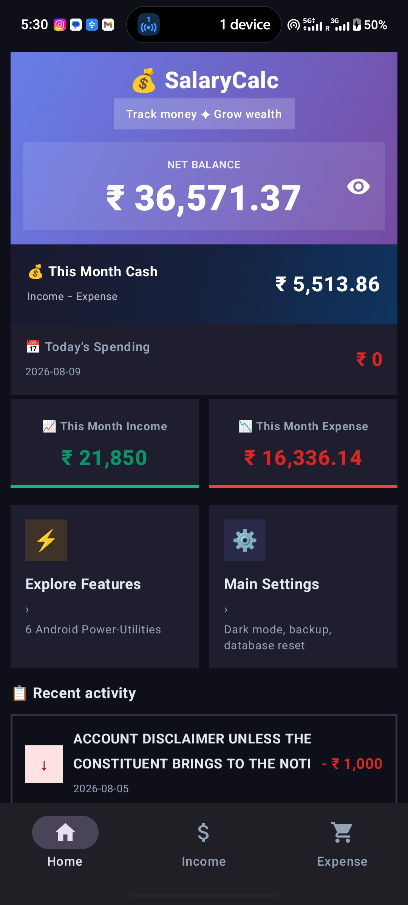
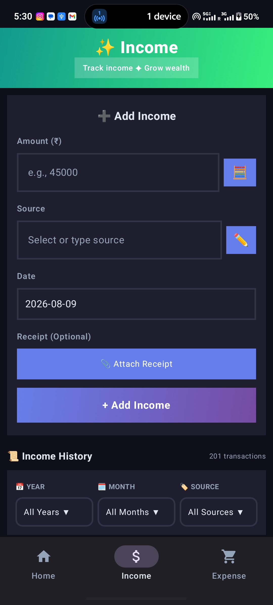
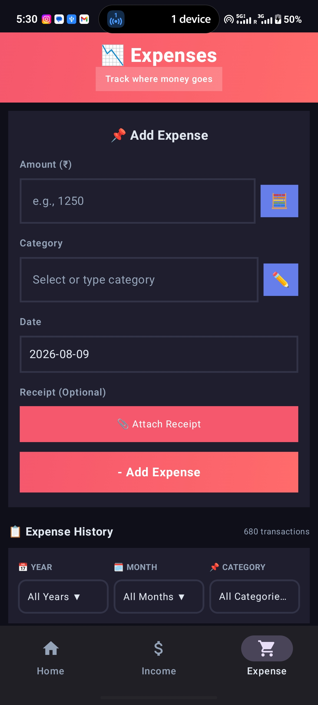

# 💰 SalaryCalc – Income & Expense Tracker

SalaryCalc is an Android personal finance application designed to help users manage **income, expenses, bank transactions, loans, fixed deposits, and financial records** in one place.

## 📸 Screenshots

  
  
  

## ✨ Features

### 💰 Income & Expense Management

* Add and manage income and expenses
* 🤖 Automatic income & expense tracking
* Automatic transaction detection from bank notifications
* Automatic transaction categorization
* Custom transaction categories
* Transaction notes
* Receipt attachment

### 🏦 Bank Statement Management

* 📄 Upload bank statements
* Import transactions from bank statements
* 📥 Download bank statements
* Transaction data processing and organization
* Duplicate transaction detection

### 💳 Loan Tracker

* Add and manage loans
* Track loan amounts and repayments
* Monitor outstanding balances
* Track loan payment progress

### 🏦 Fixed Deposit (FD) Tracker

* Add and manage Fixed Deposits
* 📈 Live FD tracking
* Track FD maturity
* Calculate and track FD growth
* FD increment tracking
* Monitor investment progress

### 📊 Dashboard & Reports

* Financial dashboard
* Income and expense summaries
* Spending charts and statistics
* Category-wise expense analysis
* Transaction history
* Financial progress tracking

### 🔔 Notifications & Automation

* Transaction notifications
* Payment reminders
* Automatic transaction processing
* Automated income and expense entries

### 🔐 Security & Privacy

* App lock
* Local financial data management
* Secure transaction records

### 📤 Data Management

* Export transactions to CSV
* Export financial records to PDF
* ☁️ Google Drive backup
* Restore backed-up data

### 🎨 User Experience

* 🌙 Dark mode
* 💱 Multi-currency support
* Simple and user-friendly interface
* Responsive Android UI

## 🛠️ Tech Stack

* **Language:** Kotlin
* **UI:** Jetpack Compose
* **Database:** Room Database
* **Platform:** Android
* **Build System:** Gradle
* **Version Control:** Git & GitHub

## 📥 Download

**Available on Indus Appstore**

[Download SalaryCalc from Indus Appstore](https://indusapp.store/hnu7fmve?utm_source=chatgpt.com)

## ⚙️ How It Works

1. Add income, expenses, loans, or fixed deposits.
2. SalaryCalc stores and organizes financial records.
3. Bank notifications can be processed for automatic transactions.
4. Bank statements can be uploaded and imported.
5. The dashboard provides financial summaries and charts.
6. Loans and FD investments can be tracked separately.
7. Financial data can be exported or backed up.

## 📄 Bank Statement

SalaryCalc provides bank statement management to help users import and organize transaction records from their statements.

Users can:

* Upload statements
* Import transaction data
* Review transactions
* Detect duplicate transactions
* Download/export financial records

## 🚀 Project Status

**Active Development**

SalaryCalc is continuously being improved with new automation, financial tracking, reporting, and data-management features.

## 👨‍💻 Developer

**Aromal KP**

* GitHub: https://github.com/aromaappu
* Instagram: https://www.instagram.com/_ar.xmal_/

---

⭐ **If you find SalaryCalc useful, consider giving the repository a star!**
